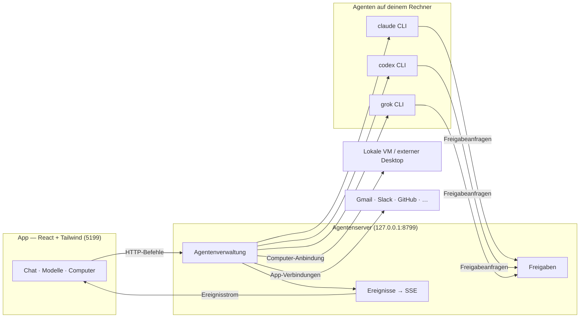

<div align="center">

# SPDBot

**Dein eigenes Team aus KI-Agenten – in einer App.**

[**Landingpage**](https://jarvis-ai-setup.antoniobeslic.chatgpt.site/) &nbsp;·&nbsp; [Releases](https://github.com/thisistoni/spdbot/releases) &nbsp;·&nbsp; [Dokumentation](docs/) &nbsp;·&nbsp; [Projekt in Linear](https://linear.app/devtones/project/spdbot-596e7a889aac)

<sub>Ein Produkt von **Antonio und Ermin · SPDLabs**. Mehrere spezialisierte Bots, eigene Modelle, verbundene Werkzeuge und gemeinsame Abläufe – lokal nutzbar und auf deine Aufgaben ausgerichtet.</sub>

Jeder Bot in der Seitenleiste ist ein eigener Agent: mit passenden Anweisungen,
einem eigenen Modell und den Werkzeugen für seine Aufgaben.
Sprich mit deinem Team wie mit Kontakten. Verfolge die Arbeit. Entscheide, was freigegeben wird.


<br>

<a href="https://github.com/thisistoni/spdbot/releases">
  
</a>
&nbsp;
<a href="https://github.com/thisistoni/spdbot/releases">
  
</a>
&nbsp;
<a href="https://github.com/thisistoni/spdbot/releases">
  
</a>
&nbsp;
<a href="https://github.com/thisistoni/spdbot/releases">
  
</a>

<sub>Desktop-Ziele der Codebasis: macOS · Windows · Ubuntu. Verfügbare SPDBot-Pakete findest du im [Releases-Bereich](https://github.com/thisistoni/spdbot/releases); bis dahin kannst du [aus dem Quellcode starten](#schnellstart).</sub>

<br>
<br>

<a href="https://linear.app/devtones/project/spdbot-596e7a889aac">
  
</a>

<br>
<br>

<sub>Entwickelt von</sub>
<br>
<strong>Antonio &amp; Ermin · SPDLabs</strong>

<br>
<br>


<sub>Die Screenshots zeigen die vorhandene App-Basis. SPDBot-Branding, deutsche Texte und neue Avatare werden gerade umgesetzt.</sub>

</div>

---

> **Unser Fokus:** SPDBot als fertiges Produkt nutzbar machen – eigenes Branding, ordentliche deutsche Texte und ein eigenständiger Bot-Look. Danach können passende Team-Templates für weitere Use Cases folgen.

## Warum SPDBot?

Ein Team kann Aufgaben besser aufteilen als ein einzelner Assistent.
SPDBot bringt spezialisierte Agenten in eine gemeinsame Chat-App:
Recherche, Texte, Code und wiederkehrende Aufgaben bekommen ihren passenden Bot.

- **Deine Agenten und Modelle.** Nutze eingerichtete Anbieter wie Claude oder Codex
  und wähle das Modell pro Bot. Weitere Engines und kompatible Endpunkte lassen
  sich über die Einstellungen ergänzen.
- **Lokal nutzbar.** Die App und ihr Agentenserver können auf deinem Rechner laufen.
  Welche externen Dienste ein Bot verwendet, hängt von den eingerichteten Modellen
  und Verbindungen ab.
- **Werkzeuge für echte Aufgaben.** Bots können mit Dateien, verbundenen Apps und
  eingerichteten Computern arbeiten. Freigaben und Zugriffsrechte bestimmst du.

## Ein Team für deine Aufgaben

| Anwendungsfall | So kannst du SPDBot einsetzen |
| --- | --- |
| **Recherche & Überblick** | Ein Bot sammelt Informationen und bereitet die Ergebnisse für dich auf. |
| **Texte & Inhalte** | Eigene Anweisungen für Entwürfe, Überarbeitung und wiederkehrende Formate. |
| **Entwicklung** | Agenten mit passendem Modell und Arbeitsordner für Code und technische Aufgaben. |
| **Organisation** | Gemeinsame Anweisungen, Gruppen und Routinen für wiederkehrende Abläufe. |
| **Eigene Use Cases** | Teams selbst zusammenstellen; angepasste SPDBot-Team-Templates sind für später vorgesehen. |

Die aktuellen Produktaufgaben und der Fortschritt stehen im
[SPDBot-Projekt in Linear](https://linear.app/devtones/project/spdbot-596e7a889aac).

## Funktionen

<table>
<tr>
<td width="50%" valign="top">

### 🧠 Das passende Modell pro Bot

Wähle Modell und Anbieter passend zur Aufgabe. Bots können unterschiedliche
Anweisungen und Modelle verwenden; die Auswahl lässt sich im Verlauf anpassen.


</td>
<td width="50%" valign="top">

### 🖥️ Ein Computer für die Aufgabe

Nutze die verfügbaren Computer-Anbindungen: einen eingerichteten Cloud-Desktop,
eine lokale VM oder die unterstützte Steuerung des eigenen Rechners.


</td>
</tr>
<tr>
<td width="50%" valign="top">

### 🙋 Freigaben direkt im Chat

Werkzeugaufrufe, Dateiänderungen und Rückfragen erscheinen im Gespräch.
Die gewählten Berechtigungen bestimmen, welche Aktionen eine Freigabe brauchen.


</td>
<td width="50%" valign="top">

### 🔌 Deine Apps verbinden

Binde eingerichtete Dienste wie Gmail, Slack, GitHub, Notion oder Linear an.
Welche Verbindungen verfügbar sind, hängt von der jeweiligen Konfiguration ab.


</td>
</tr>
<tr>
<td width="50%" valign="top">

### 🗂 Bots wie Kontakte verwalten

Bots anheften, Profile bearbeiten, Gespräche organisieren und Teams bilden.
Deine Agenten bleiben dort erreichbar, wo auch ihre Arbeit sichtbar ist.


</td>
<td width="50%" valign="top">

### 🔑 Modelle und Zugänge einrichten

Verwalte Anbieter, API-Zugänge und Verbindungen in den Einstellungen.
Die Oberfläche zeigt den Konfigurationsstatus, ohne gespeicherte Schlüssel offenzulegen.


</td>
</tr>
</table>

### #️⃣ Platz für verschiedene Kontexte

Arbeitsprojekte und persönliche Themen lassen sich in getrennten Chats und
Gruppen organisieren. Eigene Anweisungen, Arbeitsordner und Bot-Zusammenstellungen
halten die Aufgaben auseinander.

### ⚡ Den passenden Bot ansprechen

Wähle direkt den richtigen Agenten oder verwende die vorhandene automatische
Zuordnung in Gruppen. Eine optionale Entscheidungsmodell-Konfiguration unterstützt
die Auswahl; Details stehen in [docs/decision-model.md](docs/decision-model.md).

### 📦 Teams importieren und wiederverwenden

Die vorhandenen Team-Funktionen können Bots, Anweisungen, Gruppen und Abläufe
gemeinsam verpacken. Team-Dateien lassen sich importieren und vor dem Anlegen
prüfen. Zugänge und Berechtigungen werden nicht einfach mit übertragen.

Für SPDBot können daraus später eigene Vorlagen für konkrete Use Cases entstehen.
Wir verwenden dafür die bestehenden Team- und Preset-Funktionen.

### 🤝 Ein ganzes Team teilen

Teile eine Bot-Zusammenstellung statt jedes Profil einzeln einzurichten.
Die vorhandenen Export- und Importfunktionen unterstützen Team-Dateien und Presets;
der Dialog zeigt, welche Inhalte übertragen werden.

Mehr dazu: [Teams teilen](docs/team-sharing.md) ·
[Bot-Presets](docs/presets.md).

### 🎧 Antworten hören und mit Bots sprechen

Die App-Basis unterstützt Sprachausgabe über verschiedene Anbieter und lokale
Stimmen. Wähle eine Stimme im Bot-Profil und richte den benötigten Zugang ein.
Verfügbarkeit und Sprachqualität hängen vom Anbieter und der Plattform ab.

Zu den vorhandenen Optionen gehören ElevenLabs, Fish Audio, Grok (xAI),
Systemstimmen auf dem Mac und ein lokaler Chatterbox-Server.
Details zu Sprachfunktionen und Anrufen stehen in
[docs/voice-mode.md](docs/voice-mode.md).

**Außerdem dabei:** gestreamte Antworten · sichtbare Werkzeugaktivität ·
Dateien und Bilder im Gespräch · Routinen und Webhooks · eigene Bot-Profile.

**Der neue SPDBot-Look:** Für die Standard-Avatare ist
[DiceBear Bottts Neutral](https://www.dicebear.com/styles/bottts-neutral/) vorgesehen.
Eigene hochgeladene oder generierte Avatarbilder bleiben erhalten.

## Technische Basis

<div align="center">


</div>

| Baustein | Aufgabe |
| --- | --- |
| **Claude · Codex · Grok** | Agenten über eingerichtete lokale CLIs und unterstützte Modellzugänge. |
| **Electron** | Desktop-App für die vorhandenen macOS-, Windows- und Ubuntu-Ziele. |
| **React + Vite + Tailwind CSS** | Oberfläche, Gestaltung und Frontend-Build. |
| **Composio** | Konfigurierbare Verbindungen zu externen Apps. |
| **Computer-Anbindungen** | Lokale und externe Ausführungsumgebungen, je nach Einrichtung. |
| **Cua Driver** | Unterstützte Computersteuerung mit den jeweiligen Plattformgrenzen. |
| **ElevenLabs · Fish Audio · xAI** | Optionale Sprachdienste mit eigenen Zugängen. |

## So funktioniert es

Oberfläche und Agentenserver arbeiten zusammen: Die App sendet Befehle über HTTP
und empfängt den laufenden Zustand über einen Ereignisstrom.
Der Server verwaltet die Agentenprozesse, Werkzeuge und Gespräche.



| Bereich | Ort | Inhalt |
| --- | --- | --- |
| Agenten | `server/drivers/` | Anbieteranbindung und einheitliche Agentenereignisse. |
| Laufzeit | `server/harness/` | Verwaltung der laufenden Agenten und Ereignisse. |
| API | `server/index.ts` | Bots, Nachrichten, Werkzeuge, Einstellungen und Verbindungen. |
| Sprache | `server/tts/` | Sprachausgabe über eingerichtete Anbieter. |
| Oberfläche | `src/` | React-App, Chat, Einstellungen und Übersetzungen. |
| Desktop | `electron/` | Desktop-Funktionen und plattformspezifische Anbindungen. |

### SPDBot über MCP ansprechen

Die vorhandene MCP-Schnittstelle erlaubt externen Clients, Bots und Gespräche
zu prüfen, Aufgaben zu übergeben und auf Ergebnisse zu warten.
Einrichtung und verfügbare Werkzeuge:
[MCP-Dokumentation](docs/mcp-server.md).

### Aufgaben aus Skripten starten

Die Kommandozeile im Repository kann einen Workspace ohne offene Desktop-Oberfläche
ansprechen. Beispielsweise lassen sich Teams einrichten und Aufgaben mit
exportierten Ergebnissen ausführen:

```sh
corepack pnpm omb team apply team.yaml
corepack pnpm omb run "Teamleitung" "Prüfe den Start von https://example.com" --export ./out
```

Weitere Befehle: [Headless-CLI](docs/headless-cli.md).

## Schnellstart

**Desktop-Pakete:** Veröffentlichte SPDBot-Builds und Installationshinweise
erscheinen unter [Releases](https://github.com/thisistoni/spdbot/releases).
Die Codebasis enthält folgende Build-Ziele:

| Plattform | Build-Ziel | Pakete |
| --- | --- | --- |
| **macOS** (Apple Silicon) | arm64 | DMG + ZIP |
| **macOS** (Intel) | x64 | DMG + ZIP |
| **Windows** | x64 | Installer |
| **Ubuntu** | x64 | .deb / AppImage |

Die vorhandene Desktop-Architektur enthält den Agentenserver im Paket.
Für Installation und Computerfunktionen unter Linux gibt es die
[Ubuntu-Dokumentation](docs/linux-desktop.md).
Remote-Verbindungen sind unter
[Desktop-Companion](docs/desktop-companion.md) beschrieben.

**Aus dem Quellcode starten:**

Voraussetzungen: **Node.js 24+**, **pnpm 10.33.0** gemäß `package.json`
und ein eingerichteter Agent oder Modellzugang, zum Beispiel Claude Code oder Codex.
Die Befehle verwenden pnpm über **Corepack**.

```sh
git clone https://github.com/thisistoni/spdbot.git
cd spdbot
corepack pnpm install --frozen-lockfile
```

Server und Oberfläche in **zwei getrennten Terminals** im Projektordner starten:

```sh
corepack pnpm dev:server    # Terminal 1: Server auf 127.0.0.1:8799
corepack pnpm dev           # Terminal 2: App auf http://127.0.0.1:5199
```

Optional die Desktop-App in einem dritten Terminal starten und die anderen
beiden Prozesse weiterlaufen lassen:

```sh
corepack pnpm dev:desktop
```

Anschließend Modelle und Verbindungen in den Einstellungen einrichten.

**Desktop-Pakete selbst bauen:**

```sh
corepack pnpm package:mac      # macOS: DMG + ZIP, benötigt passende Xcode-/Swift-Werkzeuge
corepack pnpm package:win      # Windows: Installer
corepack pnpm package:linux    # Ubuntu x64: .deb + AppImage
```

Pakete benötigen die zum Ziel passende Build-Umgebung und native Abhängigkeiten.

### Plattformfunktionen der vorhandenen Basis

| Funktion | macOS | Ubuntu Xorg | Ubuntu Wayland |
| --- | --- | --- | --- |
| Chat, lokaler Agentenserver, Agenten-CLIs | Vorhanden | Vorhanden | Vorhanden |
| Eingerichtete externe Apps und Computer | Anbieterabhängig | Anbieterabhängig | Anbieterabhängig |
| Vorschau des eigenen Bildschirms | Plattformabhängig | Plattformabhängig | Plattformabhängig |
| Bot-Steuerung des eigenen Rechners | Nach Freigabe | Nach ausdrücklicher Aktivierung | Deaktiviert |
| Native Diktierfunktion | Vorhanden | Nicht nativ integriert | Nicht nativ integriert |

Weitere Grenzen und die jeweilige Einrichtung stehen in den
[Linux-Hinweisen](docs/linux-desktop.md) und der
[Computer-Use-Dokumentation](docs/computer-use-integration.md).

### Optionale Verbindungen

Richte nur die Dienste ein, die du tatsächlich verwenden möchtest:

| Zugang | Funktion | Einrichtung |
| --- | --- | --- |
| **Agent / Modellanbieter** | Antworten und Agentenaufgaben | Einstellungen für Engines und Verbindungen. |
| **Composio** | Externe Apps anbinden | [Composio-Dokumentation](docs/composio.md). |
| **Computer-Anbieter** | Externe Arbeitsumgebung für einen Bot | Anbieterzugang und Computer-Einstellungen. |
| **ElevenLabs** | Optionale Sprachfunktionen | [API-Schlüssel](https://elevenlabs.io/app/settings/api-keys). |
| **Fish Audio** | Optionale Sprachfunktionen | [API-Schlüssel](https://fish.audio/app/api-keys/). |

Externe Anbieter haben eigene Konten, Verfügbarkeit und gegebenenfalls Kosten.
SPDBot-Zugänge ersetzen keine Abonnements oder API-Zugänge dieser Dienste.

**Vorhandene Entwicklungschecks:**

```sh
corepack pnpm lint             # Statische Codeprüfung
corepack pnpm typecheck        # Typprüfung für Oberfläche und Server
corepack pnpm i18n:check        # Übersetzungskataloge und Platzhalter
corepack pnpm test             # Vorhandene Tests und Paket-/Desktop-Checks
corepack pnpm build            # Typprüfung und Frontend-Build
corepack pnpm check:electron   # Syntaxprüfung der Electron-Dateien
```

### Routinen, Zeitpläne und Webhooks

Bots können wiederkehrende Aufgaben und Ereignisse als Auslöser nutzen:
eine Zusammenfassung am Morgen, ein regelmäßiger Check oder ein eingerichteter
Webhook. Die Oberfläche zeigt Routinen und ihren Zustand.

Zeitpläne und verfügbare App-Ereignisse hängen von der jeweiligen Einrichtung ab.
Die zugehörigen technischen Hinweise stehen in
[Routinen](docs/routine-schedules.md) und
[Composio](docs/composio.md).

Der vorhandene Webhook-Empfänger läuft standardmäßig auf
`127.0.0.1:8800`; `OMB_WEBHOOK_PORT` kann den Port anpassen.
Für Zustellungen muss der Empfänger erreichbar sein und laufen.
Details zur Bereitstellung stehen in
[Self-Hosting](docs/self-hosting.md).

## Projektstand

SPDBot entsteht auf einer vorhandenen, funktionsreichen App-Basis.
Der aktuelle Fokus ist bewusst klein:

- **Rebranding:** SPDBot statt der bisherigen Produktnamen und Werbeverweise.
- **Deutsch:** Fehlende oder unpassende Texte in den genutzten Screens korrigieren.
- **Avatare:** DiceBear Bottts Neutral als Standard einführen und eigene Bilder erhalten.
- **Kurzcheck:** Kernablauf und die tatsächlich ausgelieferten Builds prüfen.

Eigene Team-Templates für weitere Anwendungsfälle kommen bei Bedarf danach.
Fortschritt und Aufgaben:
[SPDBot in Linear](https://linear.app/devtones/project/spdbot-596e7a889aac).

Weitere technische Möglichkeiten:
[eigene Engines](docs/custom-engines.md) ·
[eigene MCP-Server](docs/custom-mcp-servers.md) ·
[weitere Modellanbieter](apps/docs/content/docs/providers/model-providers.mdx).

## Datenschutz

Die App-Basis bietet optionale Nutzungsanalysen.
Die Einstellung findest du unter den allgemeinen Einstellungen;
[docs/analytics.md](docs/analytics.md) beschreibt die erfassten Ereignisse.

Welche Daten ein Modell oder eine verbundene App verarbeitet, hängt von den
eingerichteten Diensten und ihren jeweiligen Bedingungen ab.

## Gemeinsam entwickeln

**Branch → ändern → prüfen → committen → pushen → PR → mergen.**

Antonio und Ermin arbeiten mit ihren Agents an kleinen, klaren Aufgaben.
Die Agents führen durch die Git-Schritte, lösen klare Merge-Konflikte und mergen
Routineänderungen nach den nötigen Checks und Freigaben.
Antonios Dot übernimmt regelmäßige technische PR-Reviews.

Arbeitsregeln: [AGENTS.md](AGENTS.md) ·
[Kurzer Plan](docs/plans/spdbot-rebrand.md).

Die Landingpage wird im eigenen Repository
[SPD-Studio](https://github.com/thisistoni/SPD-Studio) gepflegt.
Sie begann als Hermes-Anleitung und wird bei Bedarf an das SPDBot-Produkt angepasst.
App und Website gehören vorerst ins selbe Linear-Projekt.

## Im Terminal oder auf einem Server nutzen

Starte die Kommandozeile aus diesem Repository mit Node.js 24+:

```sh
corepack pnpm omb
```

Die vorhandene Einrichtung führt durch Agenten- oder API-Zugänge und
Modellauswahl. Mit `corepack pnpm omb setup` lässt sie sich erneut öffnen.
Die Optionen und Unterschiede zwischen den Anbietern stehen in
[CLI-Onboarding](docs/cli-onboarding.md).

Telefon- und Remote-Zugriff benötigen eine dafür eingerichtete Verbindung.
Die Hinweise erklären Pairing, Tailscale und eigene HTTPS-Bereitstellung:

- [Telefon-Web-App](docs/phone-web-app.md)
- [Desktop-Companion](docs/desktop-companion.md)
- [Server bereitstellen](docs/deploy-vps.md)
- [Self-Hosting](docs/self-hosting.md)

Verwende für ein SPDBot-Setup die Version aus diesem Repository und die dafür
veröffentlichten Pakete.

## Lizenz und Herkunft

SPDBot baut auf OpenMausBot auf.

[Apache License 2.0](LICENSE) © 2026 Milind Soni und OpenMausBot-Mitwirkende,
ausgenommen `enterprise/` mit seinen [eigenen Lizenzbedingungen](enterprise/LICENSE).
Weitere Angaben zur Nutzung und Weitergabe stehen in [LICENSING.md](LICENSING.md).
Die erforderlichen Herkunfts- und Drittanbieterhinweise bleiben in [NOTICE](NOTICE).

Die gebündelten Cua-Driver-Komponenten behalten ihre jeweiligen Lizenzen.
Lizenztexte, Quellverweise und Inventar stehen unter
[third_party/cua-driver/](third_party/cua-driver/).

Genannte Anbieter und Marken gehören ihren jeweiligen Inhabern.
